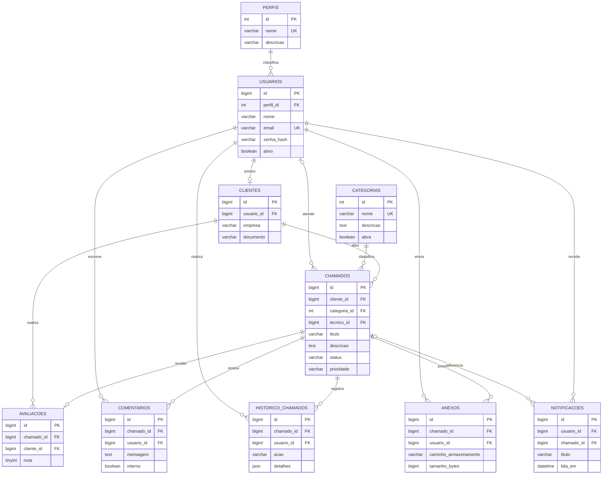

# Modelagem de Dados

**Projeto:** G-TECH  
**Documento:** MD-001  
**Versão:** 1.0

## 1. Visão geral

O banco relacional `gtech` armazena os dados de usuários, clientes, categorias, chamados, comentários, histórico, anexos, notificações e avaliações.

## 2. Diagrama Entidade-Relacionamento (DER)

## 3. Modelo lógico relacional

- **PERFIS** (`id` PK, `nome` UQ, `descricao`)
- **USUARIOS** (`id` PK, `perfil_id` FK, `nome`, `email` UQ, `senha_hash`, `telefone`, `ativo`, `criado_em`, `atualizado_em`)
- **CLIENTES** (`id` PK, `usuario_id` FK/UQ, `empresa`, `documento`, `criado_em`)
- **CATEGORIAS** (`id` PK, `nome` UQ, `descricao`, `ativa`, `criado_em`)
- **CHAMADOS** (`id` PK, `cliente_id` FK, `categoria_id` FK, `tecnico_id` FK nullable, `titulo`, `descricao`, `status`, `prioridade`, `solucao`, datas)
- **COMENTARIOS** (`id` PK, `chamado_id` FK, `usuario_id` FK, `mensagem`, `interno`, `criado_em`)
- **HISTORICO_CHAMADOS** (`id` PK, `chamado_id` FK, `usuario_id` FK, `acao`, `status_anterior`, `status_novo`, `detalhes`, `criado_em`)
- **ANEXOS** (`id` PK, `chamado_id` FK, `usuario_id` FK, `nome_original`, `nome_armazenado`, `caminho_armazenamento`, `mime_type`, `tamanho_bytes`, `criado_em`)
- **NOTIFICACOES** (`id` PK, `usuario_id` FK, `chamado_id` FK nullable, `titulo`, `mensagem`, `lida_em`, `criado_em`)
- **AVALIACOES** (`id` PK, `chamado_id` FK/UQ, `cliente_id` FK, `nota`, `comentario`, `criado_em`)

## 4. Dicionário de dados

| Tabela | Campo | Tipo | Restrições / finalidade |
|---|---|---|---|
| perfis | id | INT UNSIGNED | PK, identificador |
| perfis | nome | VARCHAR(30) | Obrigatório, único; perfil de acesso |
| usuarios | id | BIGINT UNSIGNED | PK |
| usuarios | perfil_id | INT UNSIGNED | FK para perfis |
| usuarios | nome | VARCHAR(120) | Obrigatório |
| usuarios | email | VARCHAR(190) | Obrigatório, único |
| usuarios | senha_hash | VARCHAR(255) | Hash da senha; nunca armazenar senha pura |
| usuarios | ativo | BOOLEAN | Indica se a conta pode autenticar |
| clientes | usuario_id | BIGINT UNSIGNED | FK único para usuarios |
| categorias | nome | VARCHAR(100) | Obrigatório, único |
| chamados | cliente_id | BIGINT UNSIGNED | FK para clientes |
| chamados | categoria_id | INT UNSIGNED | FK para categorias |
| chamados | tecnico_id | BIGINT UNSIGNED | FK para usuarios; aceita nulo |
| chamados | status | ENUM | Estado atual do atendimento |
| chamados | prioridade | ENUM | BAIXA, NORMAL, ALTA ou URGENTE |
| comentarios | mensagem | TEXT | Conteúdo do comentário |
| comentarios | interno | BOOLEAN | Define se o comentário é restrito à equipe |
| historico_chamados | detalhes | JSON | Dados complementares da alteração |
| anexos | caminho_armazenamento | VARCHAR(500) | Referência ao arquivo armazenado fora do banco |
| anexos | tamanho_bytes | BIGINT UNSIGNED | Tamanho do arquivo |
| notificacoes | lida_em | DATETIME | Data de leitura; nulo enquanto não lida |
| avaliacoes | nota | TINYINT UNSIGNED | Nota inteira entre 1 e 5 |

## 5. Integridade e observações

- As tabelas utilizam InnoDB para suporte a chaves estrangeiras e transações.
- Campos de identificação utilizam chaves primárias.
- Relacionamentos são implementados por chaves estrangeiras.
- Índices foram definidos para consultas frequentes por status, cliente, técnico e data.
- O arquivo SQL é a referência executável da estrutura física do banco.
- Regras que dependem de autorização ou de múltiplas tabelas deverão ser verificadas também na camada de serviço da API.
