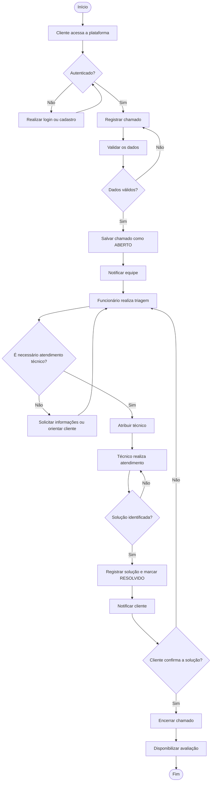
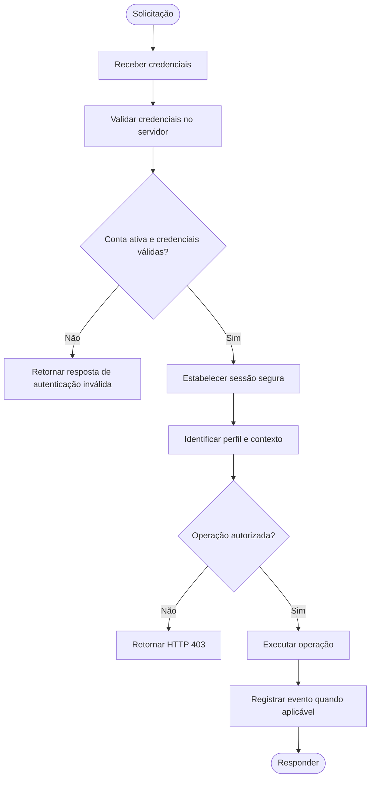
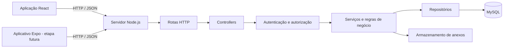

# Fluxos do Sistema e Arquitetura

**Projeto:** G-TECH  
**Documento:** FA-001  
**Versão:** 1.0

## 1. Fluxo principal de atendimento

## 2. Fluxo de autenticação e autorização

## 3. Arquitetura lógica

## 4. Justificativa das tecnologias

| Tecnologia | Aplicação | Justificativa |
|---|---|---|
| React | Interface web | Construção de interfaces baseadas em componentes. |
| JavaScript | Web e servidor | Padronização da linguagem entre as camadas. |
| CSS | Interface | Controle de identidade visual, responsividade e acessibilidade. |
| Node.js | API | Execução de JavaScript no servidor. |
| `node:http` | Servidor HTTP | Implementação sem utilização do Express. |
| MySQL | Persistência | Banco relacional com transações e integridade referencial. |
| React Native + Expo | Aplicativo futuro | Desenvolvimento móvel com base no ecossistema JavaScript. |
| Git/GitHub | Versionamento | Histórico de alterações e colaboração. |

## 5. Considerações de implantação

A aplicação web e a API serão executadas como serviços separados durante o desenvolvimento. O MySQL será executado de forma independente. Em produção, deverão ser definidos domínio, HTTPS, política de CORS, gestão de segredos, armazenamento de anexos, backup e monitoramento.
