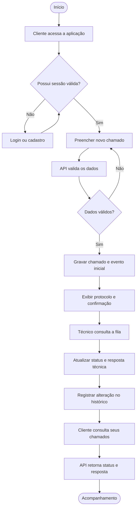
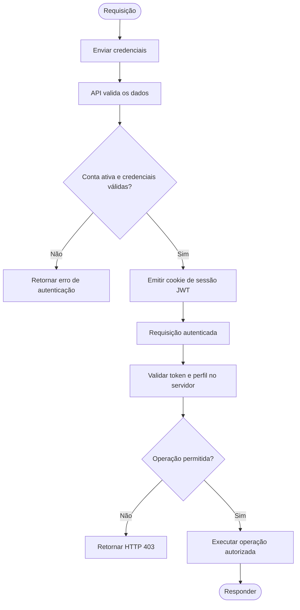
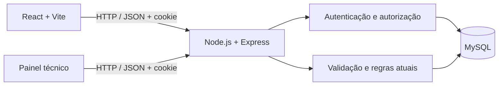

# Fluxos do Sistema e Arquitetura

**Projeto:** G-TECH  
**Documento:** FA-001  
**Versão:** 1.1

## 1. Fluxo atual de abertura e atendimento

A interface do cliente consulta os chamados periodicamente, em intervalos de 15 segundos enquanto a aplicação está aberta. Esse mecanismo é polling e não representa notificação push ou comunicação em tempo real.

## 2. Fluxo de autenticação e autorização

## 3. Arquitetura implementada

A API está atualmente concentrada em `server/index.js`, com acesso ao banco por `mysql2/promise`. A divisão em controllers, serviços e repositórios é uma possível refatoração futura, não a estrutura atual do servidor.

## 4. Tecnologias

| Tecnologia | Uso atual |
|---|---|
| React, JavaScript e CSS | Interface web |
| Vite | Servidor de desenvolvimento e build |
| React Router | Navegação entre páginas |
| Node.js | Ambiente de execução da API |
| Express | Rotas e middlewares HTTP |
| MySQL | Persistência relacional |
| mysql2 | Conexão e consultas parametrizadas |
| bcryptjs | Hash de senhas |
| jsonwebtoken | Token de sessão |
| cookie-parser | Leitura do cookie de sessão |
| Helmet, CORS e express-rate-limit | Controles básicos da API |
| React Native + Expo | Aplicativo futuro, ainda não implementado |

## 5. Considerações de implantação

Durante o desenvolvimento, front-end, API e MySQL são executados separadamente. O front-end utiliza `VITE_API_URL` quando configurada; caso contrário, aponta para `http://localhost:3000`. A API utiliza `CLIENT_ORIGIN` para configurar CORS e validar a origem das operações de escrita.

Antes de produção, definir domínio, HTTPS, cookies seguros, proteção CSRF completa, gestão de segredos, backup, monitoramento, política de retenção e armazenamento seguro de arquivos.
