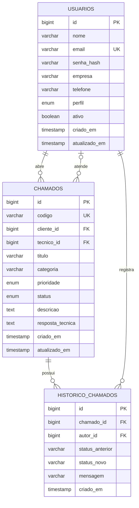

# Modelagem de Dados

**Projeto:** G-TECH  
**Documento:** MD-001  
**Versão:** 1.2  
**Banco físico:** `g_tech_suporte`

## 1. Visão geral

A modelagem abaixo representa o banco atualmente criado pelo arquivo `server/database/schema.sql`. A implementação contém três tabelas: `usuarios`, `chamados` e `historico_chamados`.

Recursos como comentários independentes, anexos, notificações, avaliações, categorias normalizadas e perfis administrativos permanecem como possibilidades de evolução e não fazem parte do schema atual.

## 2. Diagrama Entidade-Relacionamento (DER)

## 3. Modelo lógico relacional

- **USUARIOS** (`id` PK, `nome`, `email` UQ, `senha_hash`, `empresa`, `telefone`, `perfil`, `ativo`, `criado_em`, `atualizado_em`)
- **CHAMADOS** (`id` PK, `codigo` UQ, `cliente_id` FK, `tecnico_id` FK nullable, `titulo`, `categoria`, `prioridade`, `status`, `descricao`, `resposta_tecnica`, datas)
- **HISTORICO_CHAMADOS** (`id` PK, `chamado_id` FK, `autor_id` FK, `status_anterior`, `status_novo`, `mensagem`, `criado_em`)

## 4. Dicionário de dados resumido

| Tabela | Campo | Tipo | Finalidade / restrição |
|---|---|---|---|
| usuarios | id | BIGINT UNSIGNED | Chave primária |
| usuarios | nome | VARCHAR(120) | Nome do usuário |
| usuarios | email | VARCHAR(190) | Obrigatório e único |
| usuarios | senha_hash | VARCHAR(255) | Hash bcrypt; nunca armazenar senha pura |
| usuarios | perfil | ENUM | `cliente` ou `tecnico` |
| usuarios | ativo | TINYINT(1) | Indica se a conta está ativa |
| chamados | id | BIGINT UNSIGNED | Chave primária |
| chamados | codigo | VARCHAR(32) | Protocolo único exibido ao cliente |
| chamados | cliente_id | BIGINT UNSIGNED | FK para `usuarios.id` |
| chamados | tecnico_id | BIGINT UNSIGNED | FK opcional para `usuarios.id` |
| chamados | titulo | VARCHAR(160) | Resumo da solicitação |
| chamados | categoria | VARCHAR(80) | Categoria informada no chamado |
| chamados | prioridade | ENUM | Baixa, Normal, Alta ou Urgente |
| chamados | status | ENUM | Estado atual do atendimento |
| chamados | descricao | TEXT | Descrição enviada pelo cliente |
| chamados | resposta_tecnica | TEXT | Resposta registrada pela equipe |
| historico_chamados | chamado_id | BIGINT UNSIGNED | FK para `chamados.id` |
| historico_chamados | autor_id | BIGINT UNSIGNED | FK para `usuarios.id` |
| historico_chamados | status_anterior | VARCHAR(40) | Estado anterior, quando aplicável |
| historico_chamados | status_novo | VARCHAR(40) | Novo estado, quando aplicável |
| historico_chamados | mensagem | VARCHAR(1000) | Descrição do evento |

## 5. Status e integridade

Os estados aceitos pelo schema atual são:
- `Aguardando atendimento`
- `Em atendimento`
- `Aguardando cliente`
- `Resolvido`
- `Cancelado`

As tabelas utilizam InnoDB e chaves estrangeiras. Índices apoiam consultas por perfil/estado, cliente e data. O histórico registra a abertura, mudanças de status, atribuições e remoção de responsável, além de novas respostas técnicas. O índice `idx_chamados_tecnico_status_data` apoia os filtros do painel por técnico, status e data.

## 6. Migração de bancos existentes

O schema de instalação nova já inclui o índice da fila técnica. Para bancos que já foram criados anteriormente, execute `server/database/migrations/001_indice_fila_tecnica.sql` e `server/database/migrations/002_historico_mensagem_texto.sql` no phpMyAdmin. A primeira verifica se o índice existe antes de criá-lo; a segunda amplia o tipo da coluna de mensagem sem apagar os eventos existentes.

## 7. Evoluções previstas

A modelagem poderá ser ampliada para incluir comentários públicos e internos, anexos, notificações, avaliações, categorias administráveis, permissões mais granulares e trilha de auditoria. Qualquer evolução deverá atualizar o script SQL e este documento em conjunto.
